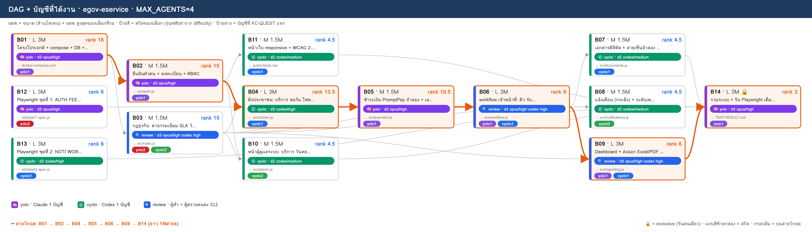
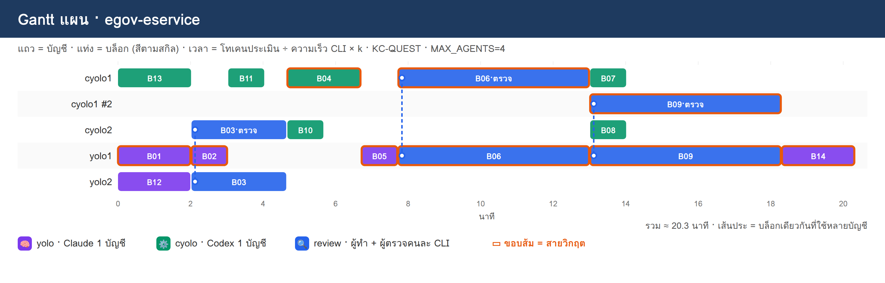

# PLAN · egov-eservice

**โจทย์:** สร้างเว็บ e-Service กลางของเทศบาลนครตัวอย่างตามชุดโจทย์ใน /workspace/egov-brief (อ่าน README.md ก่อน) ต้องทำตาม REQUIREMENTS CONTRACT TEST-DATA DECISIONS ครบทุกข้อ รันด้วย Docker Compose คำสั่งเดียว รองรับ TEST_MODE=1 และ BUG_MODE ตาม BUGS.md และมีชุด Playwright ครบทุก TC ใน TEST-PLAN.md

วางแผนเมื่อ 16/11/2026 09:30 · MAX_AGENTS 4 · บัญชี cyolo1, cyolo2, yolo1, yolo2 · ตัวปรับเวลา k {"cyolo": 0.0546, "yolo": 0.0811, "best_of": 0.0333, "review": 0.1459, "*": 0.08, "image": 0.0222}

> แผนนี้ยังไม่ได้รันจริง — KC-QUEST เลือกบัญชีจากโควตา แล้วจำลองเวลาตาม dependency

## 1) โควตาของแต่ละบัญชี

| บัญชี | แพลน | ใช้ไป 5 ชม. | ใช้ไปสัปดาห์ | headroom | รีเซ็ต/หมดอายุ (ชม.) | U | slot | ที่มา |
|---|---|---|---|---|---|---|---|---|
| cyolo1 | default | 10% | 0% | **90%** | 168.0 | 0.125 | 3 | สมมติ (--accounts) |
| cyolo2 | default | 30% | 0% | **70%** | 168.0 | 0.125 | 3 | สมมติ (--accounts) |
| yolo1 | default | 20% | 0% | **80%** | 168.0 | 0.125 | 3 | สมมติ (--accounts) |
| yolo2 | default | 40% | 0% | **60%** | 168.0 | 0.125 | 3 | สมมติ (--accounts) |

- ⚠ ทุกบัญชีเป็นค่าสมมติ (--accounts มี % ครบ) → ไม่ได้เรียก team.py check/quota

## 2) DAG + สกิล + บัญชี

**สายวิกฤต:** B01 → B02 → B04 → B05 → B06 → B09 → B14 · ยาว 18M tok

## 3) ตารางแจกงาน (เหตุผล KC-QUEST ทุกบล็อก)

| บล็อก | สกิล | ชื่อ | ขนาด · c | รอ | rank | บัญชี (บทบาท) | เริ่ม–จบ (นาที) | เหตุผล KC-QUEST |
|---|---|---|---|---|---|---|---|---|
| **B01** | 🧠 yolo | โครงโปรเจกต์ + compose + DB + test hook | L · 3 | – | 18 | yolo1 (ทำ) | 0.0–2.0 | ทำ: yolo1 31.0 (U=0.125 F=0.01 S=0.722 S=1.0 L=0.0) · 3.00M ≈ 5ชม. 7.8% / สัปดาห์ 0.98% · อันดับ 2 yolo2 28.0 |
| B12 | 🧠 yolo | Playwright ชุดที่ 1: AUTH FEE SUBMIT UPLOAD PAY QUEUE SLA | L · 3 | – | 6 | yolo2 (ทำ) | 0.0–2.0 | ทำ: yolo2 18.0 (U=0.125 F=0.01 S=0.522 S=0.333 L=0.0) · 3.00M ≈ 5ชม. 7.8% / สัปดาห์ 0.98% · อันดับ 2 yolo1 16.5 |
| B13 | ⚙️ cyolo | Playwright ชุดที่ 2: NOTI WORKFLOW DOC PDPA DASH AUDIT RBAC NFR | L · 3 | – | 6 | cyolo1 (ทำ) | 0.0–2.0 | ทำ: cyolo1 21.0 (U=0.125 F=0.01 S=0.822 S=0.233 L=0.0) · 3.00M ≈ 5ชม. 7.8% / สัปดาห์ 0.98% · อันดับ 2 cyolo2 18.0 |
| **B02** | 🧠 yolo | ยืนยันตัวตน + ลงทะเบียน + RBAC | M · 1.5 | B01 | 15 | yolo1 (ทำ) | 2.0–3.0 | ทำ: yolo1 27.8 (U=0.125 F=0.005 S=0.683 S=0.833 L=0.0) · 1.50M ≈ 5ชม. 3.9% / สัปดาห์ 0.49% · อันดับ 2 yolo2 24.8 |
| B03 | 🔍 review | กฎธุรกิจ: ค่าธรรมเนียม SLA วันทำการ วันหยุด | M · 1.5 | B01 | 15 | yolo2 (ทำ), cyolo2 (ตรวจ) | 2.0–4.7 | ทำ: yolo2 24.8 (U=0.125 F=0.005 S=0.483 S=0.833 L=0.0) · 1.50M ≈ 5ชม. 3.9% / สัปดาห์ 0.49% · อันดับ 2 yolo1 23.9   ตรวจ: cyolo2 24.1 (U=0.125 F=0.001 S=0.688 S=0.583 L=0.0) · 0.45M ≈ 5ชม. 1.17% / สัปดาห์ 0.15% · อันดับ 2 cyolo1 22.6 |
| B11 | ⚙️ cyolo | หน้าเว็บ responsive + WCAG 2.2 AA | M · 1.5 | B02 | 4.5 | cyolo1 (ทำ) | 3.0–4.1 | ทำ: cyolo1 19.5 (U=0.125 F=0.005 S=0.783 S=0.175 L=0.0) · 1.50M ≈ 5ชม. 3.9% / สัปดาห์ 0.49% · อันดับ 2 cyolo2 14.1 |
| **B04** | ⚙️ cyolo | ฝั่งประชาชน: บริการ ฟอร์ม ไฟล์แนบ ร่าง ยกเลิก | L · 3 | B02, B03 | 13.5 | cyolo1 (ทำ) | 4.7–6.7 | ทำ: cyolo1 23.6 (U=0.125 F=0.01 S=0.705 S=0.525 L=0.0) · 3.00M ≈ 5ชม. 7.8% / สัปดาห์ 0.98% · อันดับ 2 cyolo2 22.2 |
| B10 | ⚙️ cyolo | หน้าผู้ดูแลระบบ: บริการ วันหยุด ผู้ใช้ | M · 1.5 | B02, B03 | 4.5 | cyolo2 (ทำ) | 4.7–5.7 | ทำ: cyolo2 17.5 (U=0.125 F=0.005 S=0.649 S=0.175 L=0.0) · 1.50M ≈ 5ชม. 3.9% / สัปดาห์ 0.49% · อันดับ 2 cyolo1 14.4 |
| **B05** | 🧠 yolo | ชำระเงิน PromptPay จำลอง + เลขคำขอ + ใบเสร็จ | M · 1.5 | B03, B04 | 10.5 | yolo1 (ทำ) | 6.7–7.7 | ทำ: yolo1 23.5 (U=0.125 F=0.005 S=0.644 S=0.583 L=0.0) · 1.50M ≈ 5ชม. 3.9% / สัปดาห์ 0.49% · อันดับ 2 yolo2 20.5 |
| **B06** | 🔍 review | workflow เจ้าหน้าที่: คิว รับเรื่อง ตีกลับ ส่งต่อ อนุมัติ | L · 3 | B03, B05 | 9 | yolo1 (ทำ), cyolo1 (ตรวจ) | 7.7–13.0 | ทำ: yolo1 21.2 (U=0.125 F=0.01 S=0.566 S=0.5 L=0.0) · 3.00M ≈ 5ชม. 7.8% / สัปดาห์ 0.98% · อันดับ 2 cyolo1 19.9   ตรวจ: cyolo1 20.5 (U=0.125 F=0.003 S=0.682 S=0.35 L=0.0) · 0.90M ≈ 5ชม. 2.34% / สัปดาห์ 0.29% · อันดับ 2 cyolo2 19.7 |
| **B09** | 🔍 review | Dashboard + ส่งออก Excel/PDF + Audit Trail | L · 3 | B03, B06 | 6 | yolo1 (ทำ), cyolo1 (ตรวจ) | 13.0–18.3 | ทำ: yolo1 17.5 (U=0.125 F=0.01 S=0.488 S=0.333 L=0.0) · 3.00M ≈ 5ชม. 7.8% / สัปดาห์ 0.98% · อันดับ 2 yolo2 16.3   ตรวจ: cyolo1 14.5 (U=0.125 F=0.003 S=0.619 S=0.233 L=0.333) · 0.90M ≈ 5ชม. 2.34% / สัปดาห์ 0.29% · อันดับ 2 cyolo2 14.0 |
| B07 | ⚙️ cyolo | เอกสารดิจิทัล + ลายเซ็นจำลอง + หน้าตรวจเอกสาร | M · 1.5 | B06 | 4.5 | cyolo1 (ทำ) | 13.0–14.0 | ทำ: cyolo1 17.4 (U=0.125 F=0.005 S=0.643 S=0.175 L=0.0) · 1.50M ≈ 5ชม. 3.9% / สัปดาห์ 0.49% · อันดับ 2 cyolo2 16.9 |
| B08 | ⚙️ cyolo | แจ้งเตือน (กระดิ่ง) + ระดับเตือน SLA | M · 1.5 | B03, B06 | 4.5 | cyolo2 (ทำ) | 13.0–14.0 | ทำ: cyolo2 16.9 (U=0.125 F=0.005 S=0.61 S=0.175 L=0.0) · 1.50M ≈ 5ชม. 3.9% / สัปดาห์ 0.49% · อันดับ 2 cyolo1 13.5 |
| **B14** | 🧠 yolo | รวมระบบ + รัน Playwright เต็ม + BUG_MODE B01–B12 | L · 3 | B04, B05, B07, B08, B09, B10, B11, B12, B13 | 3 | yolo1 (ทำ) | 18.3–20.3 | ทำ: yolo1 13.9 (U=0.125 F=0.01 S=0.41 S=0.167 L=0.0) · 3.00M ≈ 5ชม. 7.8% / สัปดาห์ 0.98% · อันดับ 2 yolo2 13.8 |

## 4) Gantt แผน

## 5) รอบแจกงาน

| นาทีที่ | บล็อกที่เริ่ม |
|---|---|
| 0 | B01→yolo1, B12→yolo2, B13→cyolo1 |
| 2 | B02→yolo1, B03→yolo2+cyolo2 |
| 3 | B11→cyolo1 |
| 4.7 | B04→cyolo1, B10→cyolo2 |
| 6.7 | B05→yolo1 |
| 7.7 | B06→yolo1+cyolo1 |
| 13 | B07→cyolo1, B08→cyolo2, B09→yolo1+cyolo1 |
| 18.3 | B14→yolo1 |

## 6) สรุป

- บล็อก 14 · แจกได้ 14 · agent พร้อมกันสูงสุด 4/4
- เวลาประมาณ 20.3 นาที (แท่ง Gantt) · ไฟล์ผลของทีม: `/workspace/plans/egov-eservice/app/`

ต่อไป: `dagplan.py export egov-eservice` → `dagplan.py run egov-eservice` → `dagplan.py report egov-eservice`
