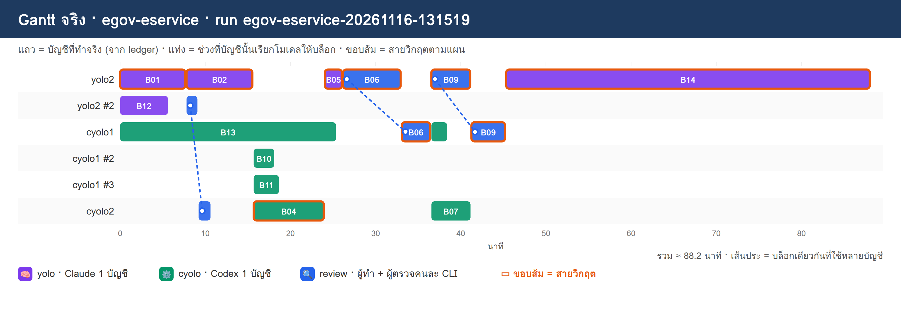
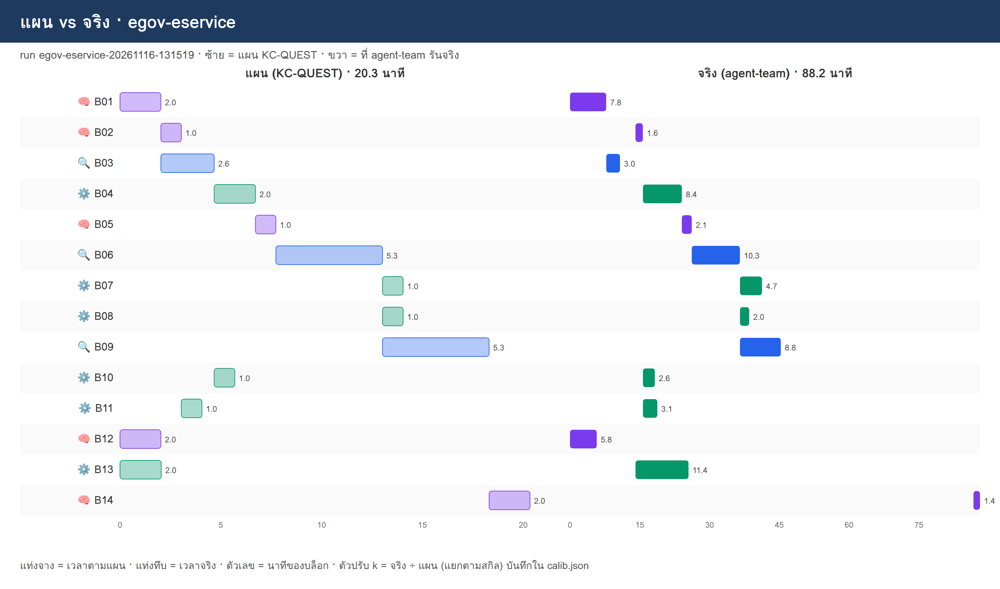

# REPORT · egov-eservice

**run:** `egov-eservice-20261116-131519` · `/workspace/.agent-team/egov-eservice-20261116-131519` · โจทย์: สร้างเว็บ e-Service กลางของเทศบาลนครตัวอย่างตามชุดโจทย์ใน /workspace/egov-brief (อ่าน README.md ก่อน) ต้องทำตาม REQUIREMENTS CONTRACT TEST-DATA DECISIONS ครบทุกข้อ รันด้วย Docker Compose คำสั่งเดียว รองรับ TEST_MODE=1 และ BUG_MODE ตาม BUGS.md และมีชุด Playwright ครบทุก TC ใน TEST-PLAN.md

## ตารางบล็อก (แผน vs จริง)

| บล็อก | สกิล | บัญชีแผน | บัญชีจริง | นาทีแผน | นาทีจริง | tokens (ไม่รวม cache read) | ครั้ง | สถานะ | ไฟล์ผล |
|---|---|---|---|---|---|---|---|---|---|
| **B01** | 🧠 yolo | yolo1(ทำ) | yolo2(ทำ) | 2.03 | 7.78 | 215,108 | 1 | ok | ✅ docker-compose.yml |
| **B02** | 🧠 yolo | yolo1(ทำ) | yolo2(ทำ) | 1.01 | 1.58 | 204,369 | 2 | ok | ✅ src/auth.js |
| B03 | 🔍 review | yolo2(ทำ), cyolo2(ตรวจ) | yolo2(ทำ), cyolo2(ตรวจ) | 2.64 | 2.95 | 118,587 | 2 | ok | ✅ src/rules.js |
| **B04** | ⚙️ cyolo | cyolo1(ทำ) | cyolo2(ทำ) | 2.05 | 8.37 | 111,972 | 1 | ok | ✅ src/citizen.js |
| **B05** | 🧠 yolo | yolo1(ทำ) | yolo2(ทำ) | 1.01 | 2.13 | 105,569 | 1 | ok | ✅ src/payment.js |
| **B06** | 🔍 review | yolo1(ทำ), cyolo1(ตรวจ) | yolo2(ทำ), cyolo1(ตรวจ) | 5.29 | 10.35 | 369,266 | 2 | ok | ✅ src/workflow.js |
| B07 | ⚙️ cyolo | cyolo1(ทำ) | cyolo2(ทำ) | 1.02 | 4.73 | 56,017 | 1 | ok | ✅ src/documents.js |
| B08 | ⚙️ cyolo | cyolo2(ทำ) | cyolo1(ทำ) | 1.02 | 1.98 | 52,383 | 1 | ok | ✅ src/notifications.js |
| **B09** | 🔍 review | yolo1(ทำ), cyolo1(ตรวจ) | yolo2(ทำ), cyolo1(ตรวจ) | 5.29 | 8.78 | 228,757 | 2 | ok | ✅ src/reporting.js |
| B10 | ⚙️ cyolo | cyolo2(ทำ) | cyolo1(ทำ) | 1.02 | 2.55 | 61,287 | 1 | ok | ✅ src/admin.js |
| B11 | ⚙️ cyolo | cyolo1(ทำ) | cyolo1(ทำ) | 1.02 | 3.10 | 46,519 | 1 | ok | ✅ public/style.css |
| B12 | 🧠 yolo | yolo2(ทำ) | yolo2(ทำ) | 2.03 | 5.75 | 199,150 | 1 | ok | ✅ e2e/part1.spec.js |
| B13 | ⚙️ cyolo | cyolo1(ทำ) | cyolo1(ทำ) | 2.05 | 11.40 | 95,451 | 2 | ok | ✅ e2e/part2.spec.js |
| **B14** | 🧠 yolo | yolo1(ทำ) | yolo2(ทำ) | 2.03 | 1.40 | 222,401 | 2 | ok | ✅ TEST-RESULT.md |

- tokens รวมของบล็อก **2,086,836** = ผลรวมจาก ledger ของ run (20 การเรียก) **2,086,836** ✅ ตรงกัน
- การเรียกที่ไม่ใช่บล็อก (ตรวจความพร้อม ฯลฯ): 0 ครั้ง · 0 tokens (ไม่นับในตาราง)
- เวลารวม: แผน 20.3 นาที · จริง 88.2 นาที
- บล็อกเสร็จ 14/14

## ภาพ

## ความต่างระหว่างแผนกับของจริง

- B01: แผน yolo1(ทำ) → จริง yolo2(ทำ)
- B02: แผน yolo1(ทำ) → จริง yolo2(ทำ)
- B04: แผน cyolo1(ทำ) → จริง cyolo2(ทำ)
- B05: แผน yolo1(ทำ) → จริง yolo2(ทำ)
- B06: แผน yolo1(ทำ), cyolo1(ตรวจ) → จริง yolo2(ทำ), cyolo1(ตรวจ)
- B07: แผน cyolo1(ทำ) → จริง cyolo2(ทำ)
- B08: แผน cyolo2(ทำ) → จริง cyolo1(ทำ)
- B09: แผน yolo1(ทำ), cyolo1(ตรวจ) → จริง yolo2(ทำ), cyolo1(ตรวจ)
- B10: แผน cyolo2(ทำ) → จริง cyolo1(ทำ)
- B14: แผน yolo1(ทำ) → จริง yolo2(ทำ)
- (export ส่งเป็นฝั่ง yolo/cyolo ไม่ผูกบัญชี เพื่อให้ failover ของ agent-team ทำงาน → agent-team เลือกบัญชีในฝั่งเองตามโหลด/โควตา ดู references/run.md)
- event worker_switch: B02 yolo2→ yolo2 ล้มเพราะ not_logged_in

## ตัวปรับเวลา k (calib.json)

`/workspace/plans/calib.json`: {"yolo": 0.1865, "review": 0.2437, "cyolo": 0.2142}

k = นาทีจริง ÷ นาทีแผน (ก่อนคูณ k) แยกตามสกิล · `plan` ครั้งถัดไปคูณเวลาแต่ละบล็อกด้วย k ของสกิลนั้น
